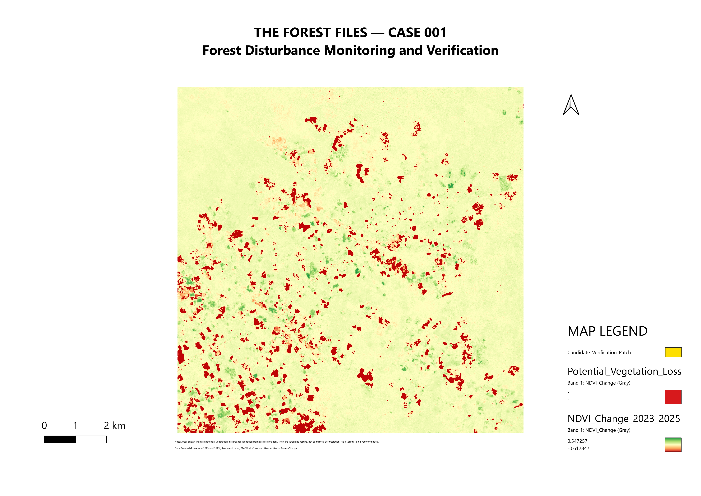
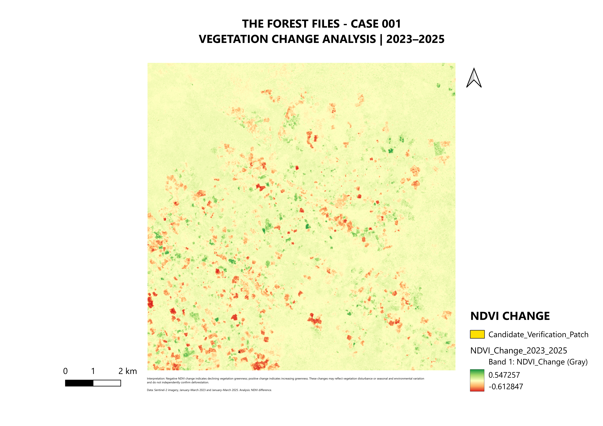
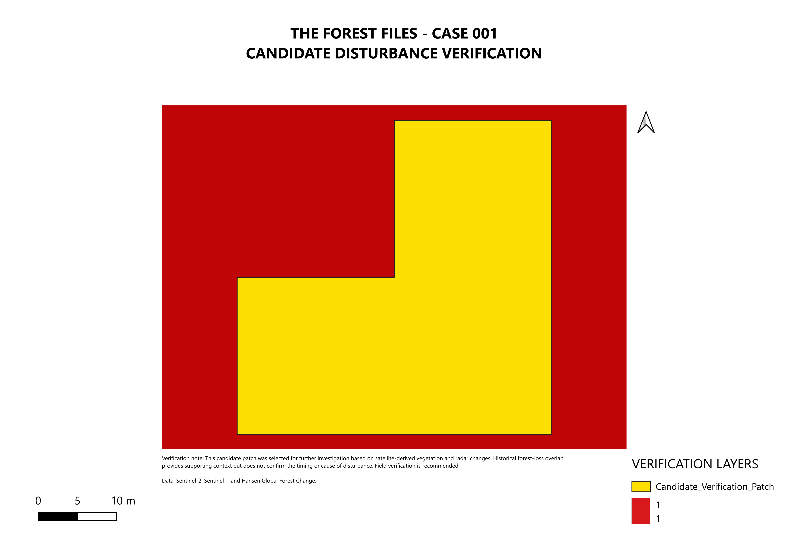

# THE FOREST FILES
## Case 001 — Forest Disturbance Monitoring and Verification

**A satellite-based geospatial workflow for detecting potential vegetation disturbance and prioritising candidates for further verification.**

This case study demonstrates how optical satellite imagery, radar observations, historical forest-loss data and GIS cartography can be combined to investigate possible changes in forest conditions.

> **Important:** The results are preliminary disturbance-screening findings. Potential vegetation loss is not equivalent to independently verified deforestation.

## Project Overview

Forests can change between satellite observations, but detecting a change is only the first step. Reliable monitoring also requires investigating candidate areas, comparing independent data sources and communicating uncertainty.

In this case study, I developed a workflow in Google Earth Engine and QGIS to:

- Compare vegetation conditions between January–March 2023 and January–March 2025.
- Use Sentinel-2 imagery and NDVI to screen for vegetation change.
- Use Sentinel-1 radar observations as supporting evidence.
- Compare a candidate disturbance patch with historical forest-loss information.
- Calculate potential-loss area at different spatial resolutions.
- Produce maps and a technical report documenting the findings and limitations.

## Key Findings

| Indicator | Result |
|---|---:|
| Study area | 12,352.57 ha |
| Baseline tree-cover area from ESA WorldCover | 11,650.05 ha |
| Mean NDVI change | -0.017 |
| Potential vegetation-loss estimate at 10 m | 647.42 ha |
| Potential vegetation-loss estimate at 20 m | 637.15 ha |
| Potential vegetation gain at 10 m | 233.86 ha |
| Candidate patch area | 0.120 ha |
| Candidate overlap with historical loss data | 61.0% |

These figures describe the output of the screening workflow. They should not be interpreted as confirmed deforestation totals.

## Map Outputs

### 1. Study Area Overview

### 2. Vegetation Change Analysis, 2023–2025

### 3. Candidate Disturbance Verification

## Data and Tools

- **Google Earth Engine:** satellite-data processing and change detection.
- **Sentinel-2:** optical surface-reflectance imagery and NDVI analysis.
- **Sentinel-1:** radar observations used as supporting evidence.
- **ESA WorldCover:** baseline land-cover context.
- **Historical forest-loss data:** contextual comparison for candidate investigation.
- **QGIS:** map design, visual interpretation and cartographic outputs.

## Methodology

1. Define the study area.
2. Prepare comparable seasonal satellite-image collections for 2023 and 2025.
3. Calculate vegetation-index changes and screen for potential loss and gain.
4. Compare optical findings with radar observations.
5. Investigate a candidate patch using historical loss information.
6. Compare area estimates at 10 m and 20 m resolution.
7. Export maps and document uncertainty.

## Limitations

Satellite-detected changes can result from seasonal differences, moisture conditions, image quality, vegetation dynamics or other causes besides deforestation.

The 10 m and 20 m results differ, demonstrating sensitivity to spatial resolution and processing choices. Historical-loss overlap provides context but does not independently verify a disturbance event in 2025.

Independent confirmation would require additional dated imagery, higher-resolution observations, field evidence or other reliable sources.

## Technical Report

Read the full methodology, results and limitations in [`CASE_001_REPORT.md`](CASE_001_REPORT.md).

## Project Status

**Completed:** preliminary satellite-based screening, candidate-patch investigation, three map exports and technical reporting.

**Future improvement:** incorporate additional dates, improve the reproducibility of the processing workflow and obtain independent evidence for candidate verification.

---

**THE FOREST FILES** — Geospatial analysis for more informed forest monitoring.
